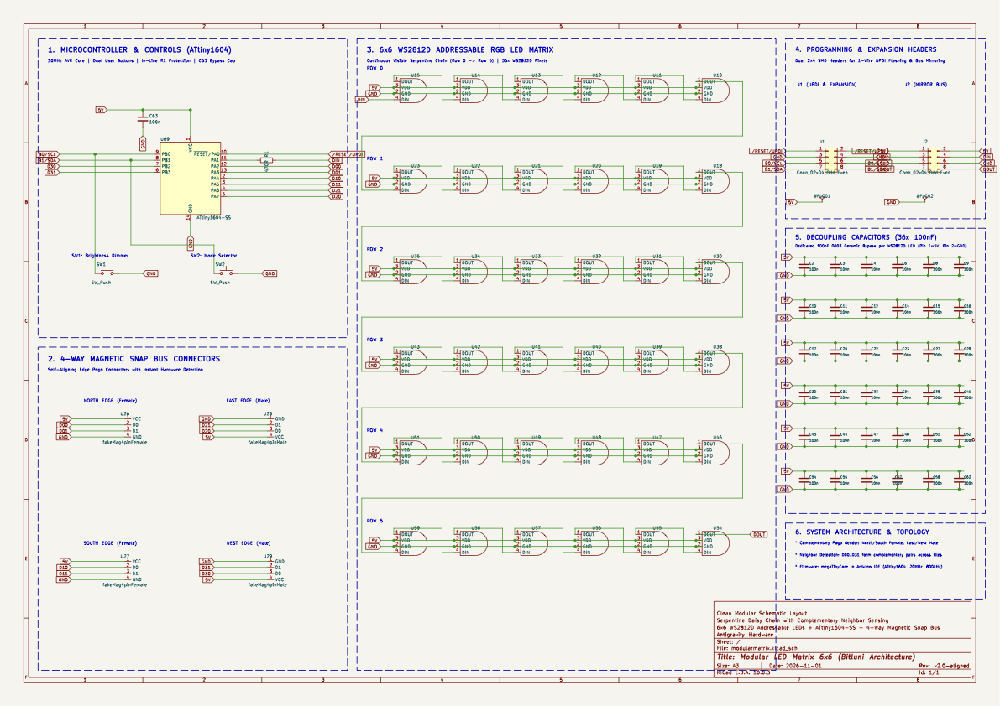

# Modular Magnetic LED Matrix (6x6 RGB)

A modular, snap-together 6x6 RGB LED matrix display system inspired by and compatible with [bitluni's magnetMatrix6x6](https://github.com/bitluni/magnetMatrix6x6).

Each individual tile features 36 addressable RGB LEDs, an onboard **Microchip ATtiny1604** microcontroller, tactile control buttons, and **4-sided magnetic pogo-pin connectors**. When brought close together, adjacent modules automatically snap into place, share power, and dynamically detect their neighbors through complementary edge-sensing pins—enabling interactive multi-tile displays and wave propagation across clusters!


---

## Key Features

- **Magnetic Snap Interconnection**: 4-pin magnetic connectors on all four sides carry DC power (`+5V`, `GND`) and dedicated neighbor detection signals.
- **Instant Hardware Neighbor Detection**: No complicated packet networking or bus negotiation required. Complementary pull-up / pull-down pin pairs on mating sides immediately pull edge inputs low upon connection, letting each tile instantly know where neighbors are attached.
- **36 Individually Addressable RGB LEDs**: Uses through-hole diffused **WS2812D** (5mm or 8mm) LEDs in a serpentine 6x6 grid.
- **Self-Contained Intelligence**: Driven by an onboard **ATtiny1604** (16KB Flash, 1KB SRAM, 20 MHz internal oscillator). Every tile can operate standalone or as part of a cluster.
- **Tactile User Interface**: 2 SMD push buttons on the rear for multi-level brightness dimming and animation mode switching.
- **1-Wire UPDI Programming**: Simple flashing via UPDI interface using any cheap USB-UART adapter (SerialUPDI) or Arduino (jtag2updi).
- **3D Printable Snap Enclosure**: Lightweight snap-fit housing with integrated light-baffle grid and optional magnetic battery backpack.
- **Upgraded to KiCad 10**: Fully updated schematic, PCB layout, symbol libraries, and footprint models.

---

## Hardware Visuals

### Schematic
The complete schematic features the ATtiny1604 microcontroller, 36 WS2812D addressable LEDs with dedicated 100nF decoupling capacitors, dual tactile push buttons, UPDI programming header, and 4 magnetic connectors.


*(Vector PDF available at [KiCad/modularmatrix_schematic.pdf](KiCad/modularmatrix_schematic.pdf))*

### PCB 3D Views (58 mm × 58 mm)

| Front (LED Grid) | Back (Controller & Connectors) |
| :---: | :---: |
|  |  |

---

## Bill of Materials (BOM)

| Component | Quantity | Reference(s) | Package / Description | Sourcing / Notes |
| :--- | :---: | :--- | :--- | :--- |
| **ATtiny1604-SS** | 1 | `U69` | SOIC-14 (3.9 × 8.7 mm, 1.27 mm pitch) | 8-bit AVR 0-series MCU, 16KB Flash, 20MHz |
| **WS2812D (5mm or 8mm)** | 36 | `U10` – `U68` | 4-pin through-hole diffused RGB LED | WS2812D-F5 (5mm) or WS2812D-F8 (8mm) |
| **Decoupling Capacitors (100nF)** | 37 | `C1` – `C63` | 0603 SMD, 50V X7R | 1 for each LED + 1 for ATtiny1604 VDD |
| **Resistor (470Ω)** | 1 | `R1` | 0603 SMD, 1% | Data line dampening / inrush protection for LED DIN |
| **Magnetic Connectors (Female)** | 2 | `U26`, `U27` | 4-pin 90° right-angle female magnetic connector | Spring-loaded pogo-pin magnetic connector |
| **Magnetic Connectors (Male)** | 2 | `U28`, `U29` | 4-pin 90° right-angle male magnetic connector | Flat-pad magnetic connector |
| **Tactile Push Buttons** | 2 | `SW1`, `SW2` | SMD Tactile Switch (C354946 footprint) | User input (brightness dimming & mode cycling) |
| **Pin Header (2×4)** | 2 | `J1`, `J2` | 2.54 mm pitch 2×4 SMD Pin Header | UPDI programming, power & serial expansion |

---

## How the Magnetic Edge Sensing Works

Each of the four module edges has a 4-pin magnetic connector with the following pinout:
1. **GND**
2. **+5V**
3. **Neighbor Sense Pin A**
4. **Neighbor Sense Pin B**

```
   Side 0 (Top):     PA2 (Input Pull-up)  <--->  PA3 (Output LOW / GND)
   Side 1 (Right):   PA4 (Input Pull-up)  <--->  PA5 (Output LOW / GND)
   Side 2 (Bottom):  PA6 (Input Pull-up)  <--->  PA7 (Output LOW / GND)
   Side 3 (Left):    PB3 (Input Pull-up)  <--->  PB2 (Output LOW / GND)
```

When two modules snap together:
- **Module A's Right connector** mates with **Module B's Left connector**.
- Module A's `PA4` (pulled HIGH internally) touches Module B's `PB2` (driven LOW). Module A detects a LOW signal → **Neighbor detected on Right!**
- Module B's `PB3` (pulled HIGH internally) touches Module A's `PA5` (driven LOW). Module B detects a LOW signal → **Neighbor detected on Left!**

This allows the firmware to compute an immediate 4-bit bitmask `sides` describing all connected neighbors in a single cycle:

```cpp
int sides = 
  (digitalRead(pins[0][0]) ? 0 : 1) +  // Top
  (digitalRead(pins[1][0]) ? 0 : 2) +  // Right
  (digitalRead(pins[2][0]) ? 0 : 4) +  // Bottom
  (digitalRead(pins[3][0]) ? 0 : 8);   // Left
```

---

## Repository Structure

```
modular-led-matrix/
├── Code/
│   ├── README.md                      # Detailed firmware & UPDI flashing documentation
│   ├── Matrix6x6/
│   │   └── Matrix6x6.ino              # Original bitluni reference firmware
│   └── Matrix6x6_Enhanced/
│       └── Matrix6x6_Enhanced.ino     # Multi-mode firmware (Rainbow, Plasma, Matrix Rain, Life)
├── KiCad/
│   ├── fp-lib-table                   # Footprint library table
│   ├── sym-lib-table                  # Symbol library table
│   ├── modularmatrix.kicad_pro        # KiCad 10 project file
│   ├── modularmatrix.kicad_sch        # Complete 6x6 schematic
│   ├── modularmatrix.kicad_pcb        # Fully-routed 58x58mm PCB
│   ├── modularmatrix_schematic.pdf    # Vector schematic PDF
│   ├── schematic_preview.png          # High-resolution schematic preview
│   ├── pcb_preview_top.png            # 3D render: PCB front (LEDs)
│   ├── pcb_preview_bottom.png         # 3D render: PCB back (MCU & connectors)
│   ├── lib/
│   │   ├── Library.pretty/            # Footprints (WS2812DwideC, fakemag4pin90deg, etc.)
│   │   ├── New_Library.kicad_sym      # Symbols (WS2812D_2, magnetic connectors)
│   │   └── MAXADC.kicad_sym           # Auxiliary symbols
│   └── Legacy_RP2040_MAX7219/         # Archived original XIAO RP2040 + MAX7219 prototype
├── Models/
│   ├── README.md                      # 3D printing guide & slicer settings
│   ├── top6x6.stl                     # Front light baffle grid (60 × 60 mm)
│   ├── bottom6x6.stl                  # Rear snap-in case (60 × 60 mm)
│   ├── battcase.stl                   # Battery pack holder
│   ├── battcap.stl                    # Battery pack end cap
│   ├── parts.3mf                      # Pre-arranged 3MF print project
│   └── 8x8.blend                      # Source Blender 3D CAD model
├── cover.jpg                          # Photo of assembled magnetic matrix modules
└── README.md                          # This documentation
```

---

## Getting Started

### 1. 3D Printing the Enclosure
- Open [`Models/parts.3mf`](Models/parts.3mf) in your slicer (Bambu Studio, PrusaSlicer, OrcaSlicer).
- Print `top6x6.stl` in **translucent white PLA/PETG** (or perform a filament swap with black grid walls) to achieve crisp diffusion without light bleed.
- Print `bottom6x6.stl` in **opaque black or grey PLA**.
- See [`Models/README.md`](Models/README.md) for detailed print parameters.

### 2. PCB Fabrication & Assembly
- Fabricate the PCB using the files in [`KiCad/`](KiCad/). The board is a standard 2-layer FR4 PCB with 1.6 mm thickness.
- Solder the SMD components first (ATtiny1604, 0603 capacitors, resistor, SMD buttons, SMD headers).
- Insert and solder the 36 through-hole WS2812D LEDs.
- Solder the 4 edge magnetic connectors (ensure the two male and two female connectors are placed on the designated opposing edges as marked on the silkscreen).

### 3. Firmware Flashing
1. In the Arduino IDE, add the `megaTinyCore` package:
   ```
   http://drazzy.com/package_drazzy.com_index.json
   ```
2. Select **Board: ATtiny1604**, **Clock: 20MHz Internal**.
3. Connect your UPDI programmer to the `UPDI`, `5V`, and `GND` pins on header `J1` or `J2`.
4. Open [`Code/Matrix6x6_Enhanced/Matrix6x6_Enhanced.ino`](Code/Matrix6x6_Enhanced/Matrix6x6_Enhanced.ino) and click **Upload Using Programmer**.
5. See [`Code/README.md`](Code/README.md) for full programmer wiring details (SerialUPDI / jtag2updi).

---

## Credits & References

- Original project and design by **bitluni**: [bitluni/magnetMatrix6x6](https://github.com/bitluni/magnetMatrix6x6)
- YouTube project video: [Bitluni's Magnetic Matrix Build](https://youtu.be/L2J_eNgjxio)
- ATtiny Arduino Core: [megaTinyCore by Spence Konde](https://github.com/SpenceKonde/megaTinyCore)
- UPDI Programmer: [jtag2updi by ElTangas](https://github.com/ElTangas/jtag2updi)
